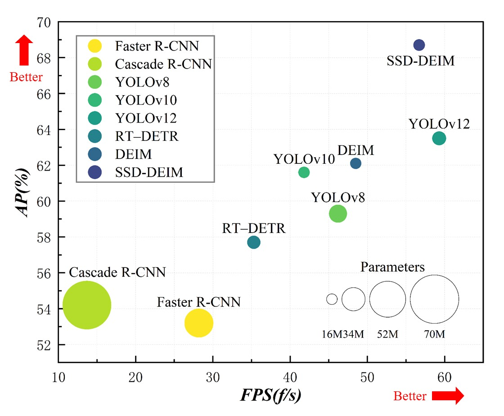

# SSD-DEIM: Preserving Multi-Scale Fidelity and Geometric Priors for Dense Camouflaged Small Object Detection

[](https://2027.ieeeicassp.org/)
[](https://arxiv.org/)
[](https://opensource.org/licenses/MIT)
[](https://www.python.org/downloads/)
[](https://pytorch.org/)

> **论文状态：** ICASSP 2027 Under Review  
> **作者：** Xian Tang<sup>1,\*</sup>, Wei Cao<sup>1,\*</sup>, Jia Wang<sup>1,†</sup>, Jun Lu<sup>2,†</sup>  
> <sup>1</sup> College of Informatics, Huazhong Agricultural University  
> <sup>2</sup> College of Engineering, Huazhong Agricultural University  
> <sup>\*</sup> Equal contribution. <sup>†</sup> Corresponding authors.

---

## 📌 更新日志

- **2026.09**：初始版本发布，包含论文核心方法、实验结果与复现代码骨架
- 代码和预训练模型即将完全开源，敬请关注

---

## 🔍 项目简介

SSD-DEIM 是一个面向**密集伪装小目标检测**的高效端到端 Transformer 检测框架。针对自然环境中绿色果实检测面临的 **"色彩高度相似 + 空间高度密集 + 目标尺度极小"** 三重挑战（SSD: **S**mall target, high **S**pectral **S**imilarity, **D**ense spatial distribution），我们以 DEIM（CVPR 2025）为基线，通过三大核心创新系统性地提升了检测精度：

| 模块 | 全称 | 解决的问题 |
|------|------|-----------|
| **DFD** | Duplex Feature Downsampling | 下采样过程中的高频边界信息丢失（空间混叠） |
| **BFF** | Gated Bidirectional Feature Fusion | 跨尺度特征融合中的背景叶噪干扰传播 |
| **L<sub>GPL</sub>** | Morphology-Aware Geometric Loss | 严重遮挡下的边界框几何形变与纵横比漂移 |

在 GC2026 柑橘果园基准测试中，SSD-DEIM 以仅 **16.1M 参数** 和 **40.1 GFLOPs** 的计算量，取得了 **68.74% AP**（**58.96% AP<sub>s</sub>**）的优异成绩，在精度与效率之间实现了出色的平衡。

---

## 🎯 性能概览

### 精度-效率权衡（GC2026 基准）



> SSD-DEIM 在精度（AP%）和推理速度（FPS）两方面均显著优于主流检测方法，同时参数量仅 16.1M。

### 可视化对比


> **定性检测结果对比。** 绿色框为真值，红色框为检测结果。蓝色圈标记漏检，黄色圈标记误检。SSD-DEIM 在密集遮挡和小目标场景下表现更优。

### 特征热力图对比


> **特征激活热力图对比。** SSD-DEIM 的特征响应更加聚焦于目标果实区域，背景叶噪被有效抑制，验证了 DFD 和 BFF 模块的有效性。

---

## 💡 研究动机

在非结构化农业环境中，密集叶冠下的绿色果实检测面临三重感知瓶颈：

1. **色彩伪装（Chromatic Camouflage）**：目标与背景叶片的光谱对比度极低（ΔE ≈ 28.5），传统特征提取器难以区分前景与背景。

2. **空间密集（High Spatial Clustering）**：单幅图像中目标数量可达 40+，相互遮挡频繁，NMS 容易误删重叠实例。

3. **尺度极小（Small Target Scale）**：远距离目标通常不足 32×32 像素，经过多次下采样后特征信号微弱。


> **Dense One-to-One 匹配范式在不同场景下的正样本分布对比。** 绿色柑橘任务中每幅图像高达 84 个正样本，远超通用检测任务。

虽然 Dense O2O 匹配范式缓解了监督稀疏性问题，但现有架构仍存在三个关键瓶颈：
- 下采样中的**空间混叠**导致高频边界信息衰减
- 无约束跨尺度聚合**传播背景噪声**
- 标准回归损失在密集遮挡下产生**纵横比畸变**

SSD-DEIM 正是为系统性解决上述问题而设计。

---

## 🏗️ 方法框架

### 整体架构

SSD-DEIM 构建了一个针对密集伪装小目标优化的表示流水线：

```
输入图像 (3, H, W)
    │
    ▼
┌─────────────────────────────────────────┐
│  Backbone with DFD Stem                  │
│  ┌─────┐  ┌─────┐  ┌─────┐  ┌─────┐    │
│  │Stage1│→│Stage2│→│Stage3│→│Stage4│    │
│  └─────┘  └─────┘  └─────┘  └─────┘    │
│     ↑ DFD (Duplex Feature Downsampling)  │
└─────────────────────────────────────────┘
    │    │    │    │ (多尺度特征)
    ▼    ▼    ▼    ▼
┌─────────────────────────────────────────┐
│  Gated Bidirectional Feature Fusion      │
│  (BFF × 3) + AIFI + CCFF                  │
└─────────────────────────────────────────┘
    │
    ▼
┌─────────────────────────────────────────┐
│  Efficient Hybrid Encoder + Decoder      │
│  Uncertainty-minimal Query Selection     │
└─────────────────────────────────────────┘
    │
    ▼
┌─────────────────────────────────────────┐
│  Detection Head                          │
│  Classification + GPL Regression Loss    │
└─────────────────────────────────────────┘
    │
    ▼
检测结果 (boxes, scores)
```

### 核心模块详解

#### 1. Duplex Feature Downsampling (DFD)

**双重特征下采样模块**通过两阶段互补滤波过程，同时保留连续轮廓和离散空间网格信息：

- **分支一（空间滤波路径）**：大核卷积（7×7 → 3×3）+ 最大池化，保留低频连续轮廓
- **分支二（空间重排路径）**：Space-to-Depth 切片采样 + 逐点投影，保留高频离散网格
- **跨分支调制（Cross-Branch Modulation）**：通过双向门控自适应重校准通道响应，防止并行表示之间的破坏性干扰

$$
Y = B\Big(K_3(K_7(X)), \; P_{\text{max}}(K_7(X))\Big)
$$
$$
Z = B\Big(K_{dw}(Y), \; P_{\text{proj}}(S_{\text{cut}}(Y))\Big)
$$

其中 $K_k$ 表示 $k \times k$ 卷积，$P_{\text{max}}$ 为最大池化，$K_{dw}$ 为深度可分离卷积，$S_{\text{cut}}$ 为空间-深度切片采样。

跨分支调制算子 $B(u, v)$ 定义为：

$$
a_u = \sigma\big(M(\text{GAP}(u))\big), \quad a_v = \sigma\big(M(\text{GAP}(v))\big)
$$
$$
B(u, v) = \big[u \odot (1 + a_v), \; v \odot (1 + a_u)\big]_c
$$

#### 2. Gated Bidirectional Feature Fusion (BFF)

**门控双向特征融合模块**通过部分卷积门控单元（PCGU）隔离前景实例，同时最小化通道冗余：


> **PCGU（Partial Convolution Gated Unit）结构示意图。**

- **通道分区策略**：将特征通道分为激活分区（C/4）和不变分区（3C/4），仅在激活分区上执行空间滤波，将计算量降至全通道卷积的约 13/16
- **元素级软门控**：通过逐元素门控 $\sigma(V)$ 抑制伪阳性叶片响应
- **双向增强**：递归地细化跨层特征，实现自顶向下和自底向上的双向信息流动

$$
G = K_{dw}\big(K_1(T_1)\big), \quad V = \sigma\big(K_1(T_1)\big)
$$
$$
\tilde{T} = \big[W_o(G \odot V), \; T_2\big]_c
$$

完整的 BFF 模块递归地细化跨层特征：

$$
F_{\text{out}} = K_1\big([T_{\text{res}}, \Phi^{(n)}_{\text{Gated}}(T_{\text{main}})]_c\big)
$$

#### 3. Morphology-Aware Geometric Loss (L<sub>GPL</sub>)

**形态感知几何损失**通过难度感知重加权策略和形态正则化项，缓解密集遮挡下的边界框回归漂移问题：

$$
L_{\text{GPL}} = 1 - \text{IoU}_f + D_{\text{shape}} + \frac{1}{2}\Omega_{\text{shape}}
$$

- **困难样本重加权（IoU<sub>f</sub>）**：为边界样本分配更大的梯度幅度，增强对困难样本的关注
- **中心距离项（D<sub>shape</sub>）**：归一化中心坐标距离，保证小目标的梯度信号不消失
- **形状正则化项（Ω<sub>shape</sub>）**：将预测框向自然的准球形几何形态正则化，有效防止密集遮挡下的边界框漂移

$$
\text{IoU}_f = \text{clamp}\left(\frac{\text{IoU} - d}{u - d}, \; 0, \; 1\right), \quad d=0.00, \; u=0.95
$$

$$
D_{\text{shape}} = \frac{\hat{h}(x_c - x_c^{gt})^2 + \hat{w}(y_c - y_c^{gt})^2}{c^2}
$$

$$
\Omega_{\text{shape}} = \sum_{t \in \{w, h\}} (1 - \exp(-\omega_t))^4
$$

其中 $\omega_w = \frac{\hat{h}|w - w^{gt}|}{\max(w, w^{gt})}$，$\omega_h = \frac{\hat{w}|h - h^{gt}|}{\max(h, h^{gt})}$。

---

## 📊 实验结果

### 跨基准测试性能

在 GC2026、MinneApple 和 VisDrone2019 三个数据集上的综合对比：

| 模型 | 来源 | GFLOPs | Param (M) | FPS | GC2026 AP | GC2026 AP<sub>s</sub> | MinneApple AP | MinneApple AP<sub>s</sub> | VisDrone AP | VisDrone AP<sub>s</sub> |
|------|------|--------|-----------|-----|-----------|----------------------|---------------|--------------------------|-------------|------------------------|
| Cascade R-CNN | TPAMI'19 | 236.1 | 69.3 | 13.7 | 54.26±0.78 | 48.67±0.66 | 39.93±0.91 | 33.69±0.49 | 24.45±0.81 | 15.94±0.46 |
| RT-DETR | CVPR'24 | 57.1 | 18.9 | 35.3 | 57.77±0.35 | 49.40±0.33 | 42.24±0.36 | 34.96±0.31 | 28.20±0.55 | 22.50±0.28 |
| YOLOv10 | NeurIPS'24 | 63.4 | 16.4 | 41.8 | 61.63±0.72 | 51.10±0.38 | 43.95±0.66 | 36.71±0.63 | 25.44±0.39 | 17.72±0.45 |
| YOLOv13 | arXiv'25 | 199.2 | 64.0 | 47.3 | 63.59±0.27 | 56.17±0.19 | 47.33±0.41 | 41.32±0.21 | 29.83±0.39 | 23.34±0.33 |
| FBRT-YOLO | AAAI'25 | 186.3 | 23.2 | 40.6 | 65.23±0.66 | 55.56±0.40 | 45.61±0.53 | 39.91±0.37 | 29.37±0.59 | 24.11±0.44 |
| DEIM | CVPR'25 | 56.9 | 16.2 | 48.5 | 62.17±0.55 | 54.72±0.63 | 44.32±0.83 | 37.12±0.60 | 28.95±0.46 | 24.52±0.37 |
| PASTA-YOLO | ICASSP'26 | 159.3 | 21.0 | 67.5 | 66.55±0.38 | 57.31±0.29 | 46.18±0.49 | 40.57±0.41 | 31.11±0.76 | 25.53±0.35 |
| **SSD-DEIM (Ours)** | **ICASSP'27** | **40.1** | **16.1** | **56.7** | **68.74±0.24** | **58.96±0.28** | **47.82±0.51** | **42.13±0.41** | 30.87±0.37 | **25.90±0.29** |

> **所有指标均报告 6 次独立随机种子实验的均值 ± 标准差（95% 置信水平）。**

**关键发现：**
- 在 GC2026 上，SSD-DEIM 相比基线 DEIM 提升 **+6.57% AP**（**+4.24% AP<sub>s</sub>**）
- 相比 PASTA-YOLO，以 **74.8% 更少的计算量** 取得了 **+2.19% AP** 的精度提升
- 在 MinneApple 跨域测试中，无需目标域参数自适应即取得 **+3.50% AP** 的提升
- 在 VisDrone2019 小目标检测中领先（**25.90% AP<sub>s</sub>**）

### 消融实验

各模块在 GC2026 数据集上的贡献度分析：

| Dense O2O | DFD | BFF | L<sub>GPL</sub> | GFLOPs | AP | AP<sub>s</sub> |
|:---------:|:---:|:---:|:--------------:|--------|----|--------------|
| ✓ | | | | 31.2 | 62.62 | 54.54 |
| ✓ | ✓ | | | 34.2 | 64.14 | 56.31 |
| ✓ | | ✓ | | 35.1 | 64.77 | 56.67 |
| ✓ | | | ✓ | 31.2 | 63.91 | 55.56 |
| ✓ | ✓ | ✓ | | 40.1 | 66.83 | 57.92 |
| ✓ | ✓ | | ✓ | 34.1 | 65.76 | 57.13 |
| ✓ | ✓ | ✓ | ✓ | 40.1 | **68.74** | **58.96** |

**模块贡献分析：**
- **DFD**：+1.52% AP / +1.77% AP<sub>s</sub>，证明抗混叠下采样有效防止早期空间细节丢失
- **BFF**：+2.15% AP / +2.13% AP<sub>s</sub>，元素级门控有效抑制欺骗性叶纹模式
- **L<sub>GPL</sub>**：在 DFD+BFF 基础上再提升 +1.91% AP / +1.04% AP<sub>s</sub>，验证了纵横比正则化回归的有效性

### 边缘部署与 INT8 量化

在 **NVIDIA Jetson Orin Nano**（8GB, 15W）上使用 TensorRT INT8 PTQ（KL-divergence 校准器）的测试结果：

| 模型 | 精度 | AP (%) | AP<sub>s</sub> (%) | 延迟 (ms) | FPS | 模型大小 (MB) |
|------|------|--------|-------------------|-----------|-----|--------------|
| RT-DETR | FP16 | 57.77 | 49.40 | 28.3 | 35.3 | 37.9 |
| RT-DETR | INT8 | 56.62 | 47.95 | 14.1 | 70.9 | 18.9 |
| DEIM | FP16 | 62.17 | 54.72 | 20.6 | 48.5 | 32.4 |
| DEIM | INT8 | 61.25 | 53.40 | 10.8 | 92.6 | 16.2 |
| PASTA-YOLO | FP16 | 66.55 | 57.31 | 14.8 | 67.5 | 42.1 |
| PASTA-YOLO | INT8 | 65.48 | 55.82 | 7.9 | 125.6 | 21.0 |
| **SSD-DEIM** | FP16 | 68.74 | 58.96 | 17.6 | 56.7 | 32.2 |
| **SSD-DEIM** | INT8 | **68.32** | **58.35** | **8.1** | **122.0** | **16.1** |

> SSD-DEIM 展现出优异的量化稳定性，FP16 → INT8 仅下降 **-0.42% AP**，显著优于 PASTA-YOLO（-1.07%）、DEIM（-0.92%）和 RT-DETR（-1.15%）。INT8 模式下实现 **122 FPS** 的实时推理速度。

---

## 📁 数据集

### GC2026 柑橘果园数据集


> **GC2025（GC2026 前身）数据集与 COCO2017 的多维度对比。** 在目标密度、遮挡程度、色彩相似度等方面，绿色柑橘检测任务显著更具挑战性。

- **图像数量**：3,470 张（增强后）
- **原始图像**：410 张高分辨率柑橘果园图像
- **数据划分**：训练集 2,776 张 / 验证集 347 张 / 测试集 347 张
- **挑战特性**：
  - 严重色彩伪装（ΔE ≈ 28.5）
  - 高度空间密集（单图 >40 个目标）
  - 小目标占比高（远距离实例 <32×32 像素）
  - 频繁相互遮挡

### 其他基准数据集

| 数据集 | 图像数 | 场景 | 用途 |
|--------|--------|------|------|
| MinneApple | 1,000 | 苹果园 | 跨域泛化验证 |
| VisDrone2019 | 10,209 | 无人机航拍 | 通用小目标检测能力验证 |

---

## 🚀 快速开始

### 环境要求

```bash
# 基础环境
Python >= 3.8
PyTorch >= 2.0
torchvision >= 0.15

# 可选依赖
numpy >= 1.24
opencv-python >= 4.8
pycocotools >= 2.0
tqdm >= 4.65
wandb >= 0.15  # （可选）训练可视化
tensorboard >= 2.14  # （可选）训练可视化
```

### 安装

```bash
# 克隆仓库
git clone https://github.com/your-username/SSD-DEIM.git
cd SSD-DEIM

# 安装依赖
pip install -r requirements.txt

# （可选）安装 CUDA 版本的 PyTorch
# pip install torch torchvision --index-url https://download.pytorch.org/whl/cu118
```

### 数据准备

将数据集按以下结构组织：

```
datasets/
├── GC2026/
│   ├── images/
│   │   ├── train/
│   │   ├── val/
│   │   └── test/
│   └── annotations/
│       ├── train.json
│       ├── val.json
│       └── test.json
├── MinneApple/
│   ├── images/
│   └── annotations/
└── VisDrone2019/
    ├── images/
    └── annotations/
```

### 训练

```bash
# 使用默认配置在 GC2026 上训练
python tools/train.py --config configs/ssd_deim_gc2026.py

# 指定 GPU 和批次大小
python tools/train.py \
    --config configs/ssd_deim_gc2026.py \
    --gpus 0,1,2,3 \
    --batch-size 16

# 恢复训练
python tools/train.py \
    --config configs/ssd_deim_gc2026.py \
    --resume work_dirs/ssd_deim_gc2026/latest.pth
```

### 评估

```bash
# 在验证集上评估
python tools/eval.py \
    --config configs/ssd_deim_gc2026.py \
    --checkpoint work_dirs/ssd_deim_gc2026/best.pth \
    --eval bbox

# 输出详细的类别-wise 结果
python tools/eval.py \
    --config configs/ssd_deim_gc2026.py \
    --checkpoint work_dirs/ssd_deim_gc2026/best.pth \
    --eval bbox \
    --classwise
```

### 推理与可视化

```bash
# 单张图像推理
python tools/infer.py \
    --config configs/ssd_deim_gc2026.py \
    --checkpoint work_dirs/ssd_deim_gc2026/best.pth \
    --input data/demo.jpg \
    --output outputs/

# 批量推理文件夹中的图像
python tools/infer.py \
    --config configs/ssd_deim_gc2026.py \
    --checkpoint work_dirs/ssd_deim_gc2026/best.pth \
    --input data/test_images/ \
    --output outputs/ \
    --conf-thres 0.3
```

### 导出与部署

```bash
# 导出 ONNX 模型
python tools/export_onnx.py \
    --config configs/ssd_deim_gc2026.py \
    --checkpoint work_dirs/ssd_deim_gc2026/best.pth \
    --output exports/ssd_deim.onnx

# INT8 量化（需要校准数据集）
python tools/quantize.py \
    --config configs/ssd_deim_gc2026.py \
    --checkpoint work_dirs/ssd_deim_gc2026/best.pth \
    --calib-dataset datasets/GC2026/calib.txt \
    --output exports/ssd_deim_int8.onnx
```

---

## 📂 仓库结构

```
SSD-DEIM/
├── configs/                # 配置文件
│   └── ssd_deim_gc2026.py  # GC2026 基准配置
├── models/                 # 模型定义
│   ├── backbone.py         # 主干网络（含 DFD 模块）
│   ├── neck.py             # 特征融合（BFF 模块）
│   ├── head.py             # 检测头 + GPL 损失
│   └── ssd_deim.py         # SSD-DEIM 整体封装
├── datasets/               # 数据集处理
│   └── gc2026.py           # GC2026 数据集类
├── tools/                  # 工具脚本
│   ├── train.py            # 训练脚本
│   ├── eval.py             # 评估脚本
│   ├── infer.py            # 推理可视化
│   ├── export_onnx.py      # ONNX 导出
│   └── quantize.py         # INT8 量化
├── figures/                # README 配图
├── requirements.txt        # Python 依赖
├── LICENSE                 # 许可证
└── README.md               # 本文件
```

---

## 📝 复现指南

### 训练超参数

| 参数 | 值 |
|------|-----|
| 优化器 | AdamW |
| 初始学习率 | 5×10⁻⁴ |
| 权重衰减 | 1×10⁻⁴ |
| 训练轮数 | 200 epochs |
| Warmup | 5 epochs 线性预热 |
| 学习率调度 | Cosine Annealing（降至 10⁻⁶） |
| 输入分辨率 | 640×640 |
| 批次大小 | 16（4×2080Ti） |
| 数据增强 | Mosaic + MixUp + RandomFlip + ColorJitter |

### 复现步骤

1. **准备环境**：按照"快速开始"部分安装依赖
2. **准备数据**：下载数据集并按目录结构组织
3. **训练**：运行训练脚本，约需 2-3 天（4×2080Ti）
4. **评估**：使用评估脚本验证最终精度
5. **注意**：报告的精度为 6 次独立实验均值 ± 标准差，单次运行可能在 ±0.5% 范围内波动

---

## ❓ 常见问题

**Q: 预训练权重什么时候发布？**  
A: 待论文接收后将第一时间开源预训练模型和完整代码，敬请 Star 关注。

**Q: GC2026 数据集如何获取？**  
A: 数据集相关信息请通过论文中的联系方式与作者沟通。

**Q: 如何在自定义数据集上训练？**  
A: 参考 `datasets/` 目录下的数据集类实现，将数据转换为 COCO 格式，然后修改配置文件中的数据集路径和类别数即可。

**Q: 模型能否部署到移动端/嵌入式设备？**  
A: 可以。SSD-DEIM 设计时充分考虑了边缘部署需求，支持 ONNX 导出和 INT8 量化，在 Jetson Orin Nano 上可达 122 FPS。

---

## 📄 引用

如果您觉得本工作对您的研究有帮助，请引用我们的论文：

```bibtex
@inproceedings{tang2027ssddeim,
  title={SSD-DEIM: Preserving Multi-Scale Fidelity and Geometric Priors for Dense Camouflaged Small Object Detection},
  author={Tang, Xian and Cao, Wei and Wang, Jia and Lu, Jun},
  booktitle={IEEE International Conference on Acoustics, Speech and Signal Processing (ICASSP)},
  year={2027}
}
```

---

## 🙏 致谢

本工作受到以下项目支持：
- 英子科技 & 华中农业大学食品健康智能研究院（IRIFH202209）
- 广西重点研发计划（No. 2025JBGS042）

感谢 DEIM（CVPR 2025）的开源代码为本工作提供了坚实的基线。

---

## 📧 联系方式

如有问题或合作意向，欢迎通过以下方式联系：

- **第一作者**：Xian Tang — [GitHub](https://github.com/your-username)
- **通讯作者**：Jia Wang, Jun Lu
- **Issues**：欢迎在 GitHub Issues 中提问

---

<p align="center">
  <a href="#top">🔝 返回顶部</a>
</p>
