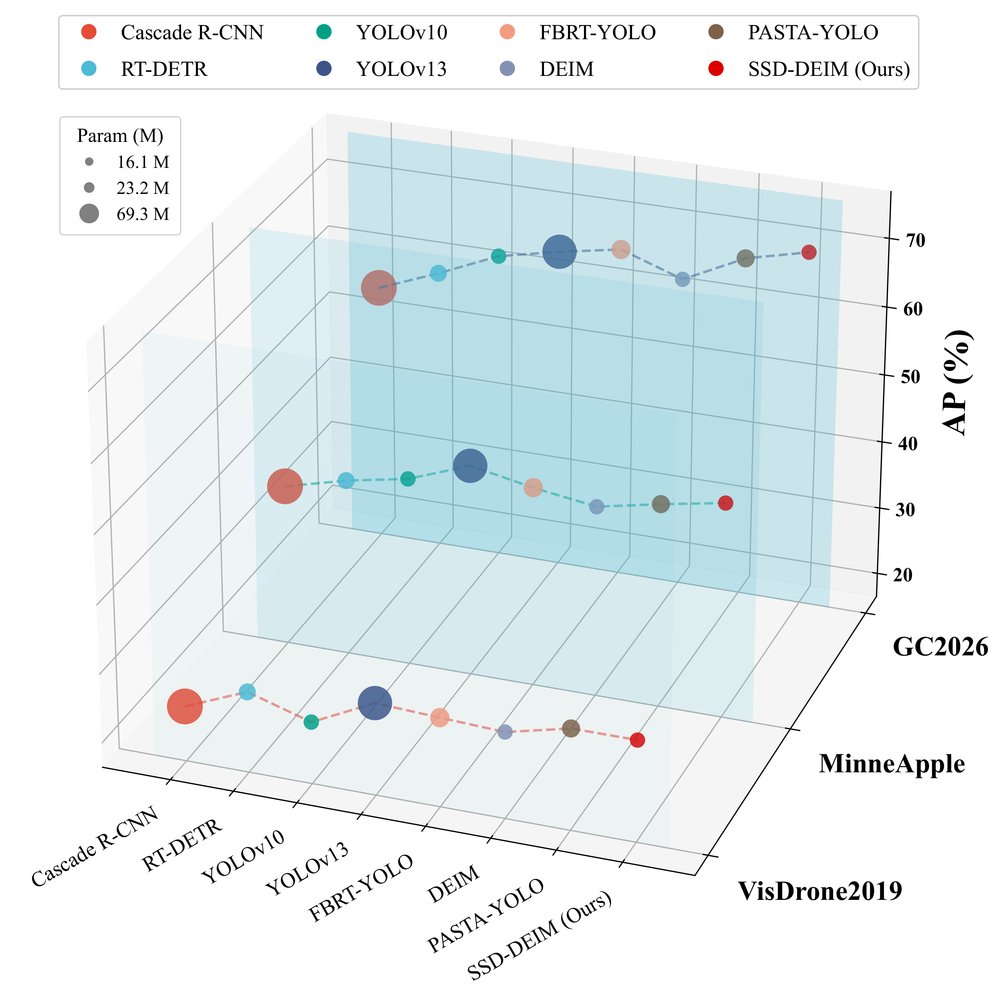
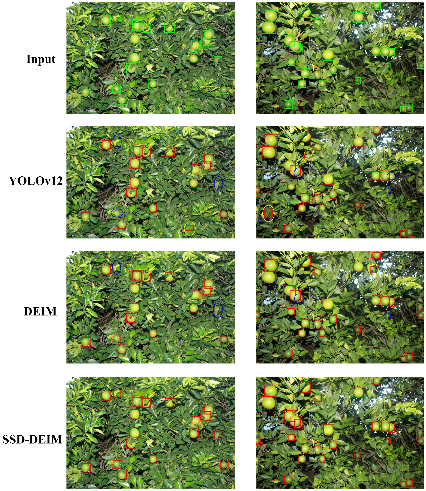
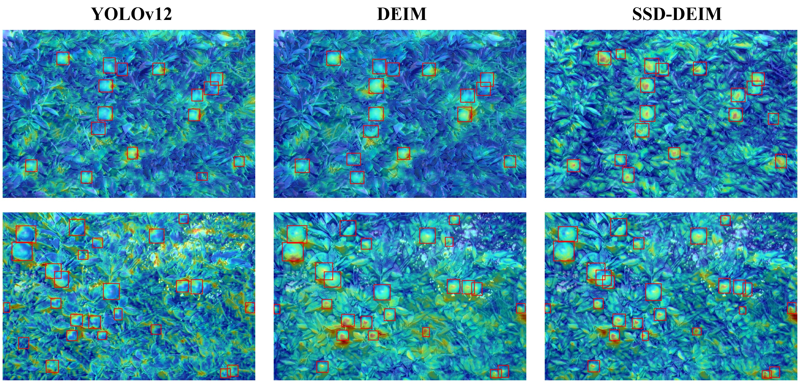
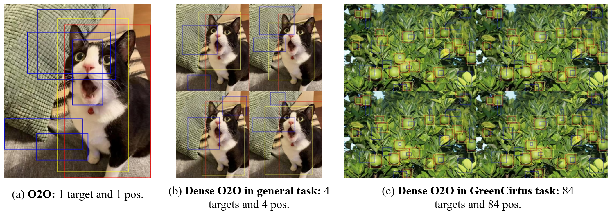
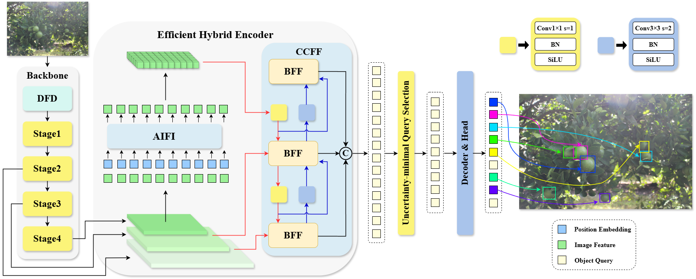
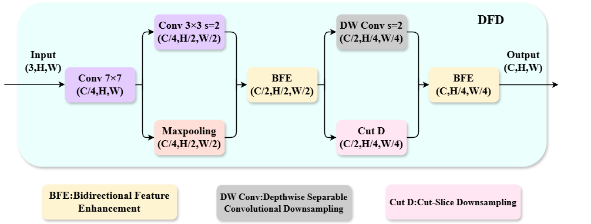
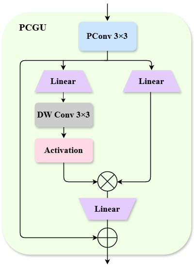
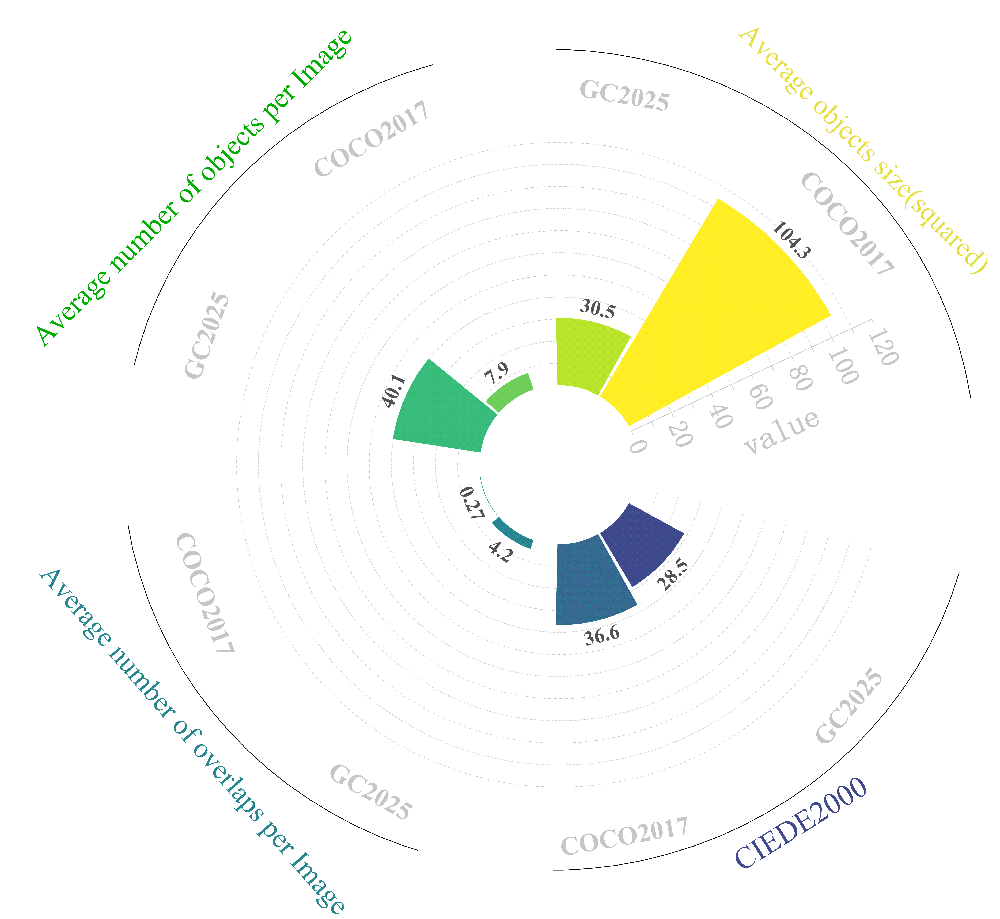

# SSD-DEIM: Preserving Multi-Scale Fidelity and Geometric Priors for Dense Camouflaged Small Object Detection

[](https://2027.ieeeicassp.org/)
[](https://opensource.org/licenses/MIT)
[](https://www.python.org/downloads/)
[](https://pytorch.org/)

> **论文状态：** ICASSP 2027 Under Review
> **作者：** Xian Tang<sup>1,\*</sup>, Wei Cao<sup>1,\*</sup>, Jia Wang<sup>1,†</sup>, Jun Lu<sup>2,†</sup>
> <sup>1</sup> College of Informatics, Huazhong Agricultural University
> <sup>2</sup> College of Engineering, Huazhong Agricultural University
> <sup>\*</sup> Equal contribution. <sup>†</sup> Corresponding authors.

---

## 📌 更新日志

- **2026.09**：初始版本发布，包含完整源码、配置文件与复现脚本

---

## 🔍 项目简介

SSD-DEIM 是一个面向**密集伪装小目标检测**的高效端到端检测框架。针对自然环境中绿色果实检测面临的 **"色彩高度相似 + 空间高度密集 + 目标尺度极小"** 三重挑战（SSD: **S**mall target, high **S**pectral **S**imilarity, **D**ense spatial distribution），我们以 DEIM（CVPR 2025）为基线，通过三大核心创新系统性地提升了检测精度：

| 模块 | 全称 | 解决的问题 |
|------|------|-----------|
| **DFD** | Duplex Feature Downsampling | 下采样过程中的高频边界信息丢失（空间混叠） |
| **BFF** | Bidirectional Feature Fusion | 跨尺度特征融合中的背景叶噪干扰传播 |
| **GPL** | Geometric Prior Loss | 严重遮挡下的边界框几何形变与纵横比漂移 |

在 GC2025 柑橘果园基准测试中，SSD-DEIM 以仅 **16.9M 参数** 和 **40.1 GFLOPs** 的计算量，取得了 **68.7% AP**（**58.9% AP<sub>s</sub>**）的优异成绩，在精度与效率之间实现了出色的平衡。

---

## 🎯 性能概览

### 精度-效率-参数量三维权衡（GC2025 基准）



> SSD-DEIM 在精度（AP%）、推理速度（FPS）和参数量（Params）三个维度上均显著优于主流检测方法，位于三维空间的帕累托前沿。

### 可视化对比



> **定性检测结果对比。** 绿色框为真值，红色框为检测结果。SSD-DEIM 在密集遮挡和小目标场景下表现更优。

### 特征热力图对比



> **特征激活热力图对比。** SSD-DEIM 的特征响应更加聚焦于目标果实区域，背景叶噪被有效抑制，验证了 DFD 和 BFF 模块的有效性。

---

## 💡 研究动机

在非结构化农业环境中，密集叶冠下的绿色果实检测面临三重感知瓶颈：

1. **色彩伪装（Chromatic Camouflage）**：目标与背景叶片的光谱对比度极低（ΔE ≈ 28.5），传统特征提取器难以区分前景与背景。

2. **空间密集（High Spatial Clustering）**：单幅图像中目标数量可达 40+，相互遮挡频繁，NMS 容易误删重叠实例。

3. **尺度极小（Small Target Scale）**：远距离目标通常不足 32×32 像素，经过多次下采样后特征信号微弱。



> **Dense One-to-One 匹配范式在不同场景下的正样本分布对比。** 绿色柑橘任务中每幅图像高达 84 个正样本，远超通用检测任务。

虽然 Dense O2O 匹配范式缓解了监督稀疏性问题，但现有架构仍存在三个关键瓶颈：
- 下采样中的**空间混叠**导致高频边界信息衰减
- 无约束跨尺度聚合**传播背景噪声**
- 标准回归损失在密集遮挡下产生**纵横比畸变**

SSD-DEIM 正是为系统性解决上述问题而设计。

---

## 🏗️ 方法框架

### 整体架构



> **SSD-DEIM 整体架构图。** 网络由三部分组成：集成 DFD 模块的 Backbone（主干网络）、基于 BFF 的双向特征融合 Neck、以及搭载 GPL 损失的检测 Head。

SSD-DEIM 以 DEIM 为基线，针对密集伪装小目标场景进行了系统性改进：

- **Backbone**：在主干网络的早期下采样阶段引入 **DFD（Duplex Feature Downsampling）** 模块，通过双路互补下采样与双向特征增强，缓解空间混叠，保留高频边界信息
- **Neck**：提出 **BFF（Bidirectional Feature Fusion）** 双向特征融合单元，以 BFE 替代简单拼接，以 PCGU（部分卷积门控单元）替代标准卷积块，在抑制背景噪声的同时降低计算开销
- **Head**：设计 **GPL（Geometric Prior Loss）** 几何先验损失（Focaler-ShapeIoU），融合难样本聚焦机制与形状感知代价项，校正密集遮挡下的边界框纵横比漂移

### 核心模块详解

#### 1. Duplex Feature Downsampling (DFD)



> **DFD（双重特征下采样模块）结构示意图。** 采用两层渐进式下采样架构，每层包含空间滤波分支和空间重排分支，通过 BFE 双向特征增强进行交叉调制。

**双重特征下采样模块**通过双层多分支融合架构，同时保留连续轮廓和离散空间网格信息：

- **双层渐进式下采样**：构建两层下采样阶段，逐步降低空间分辨率，每层都融合多种互补算子
- **分支一（空间滤波路径）**：3×3 卷积 + 7×7 大核卷积 + 最大池化，捕获低频连续轮廓特征
- **分支二（空间重排路径）**：深度可分离卷积 + 切片下采样（PixelUnshuffle），保留高频离散网格结构
- **双向特征增强（BFE）**：通过 SE 通道注意力机制对两分支特征分别生成权重，再进行交叉增强（加权特征与另一分支原始特征相加），最后拼接。实现"加权-交叉-拼接"三步过程

BFE 的数学表达如下：

$$
a_1 = \sigma(\text{SE}(F_1)), \quad a_2 = \sigma(\text{SE}(F_2))
$$

$$
F_{\text{out}} = [F_1 \odot (1 + a_2), \; F_2 \odot (1 + a_1)]_c
$$

其中 $\text{SE}(\cdot)$ 表示通道注意力（Squeeze-and-Excitation），$\sigma$ 为 Sigmoid 函数，$[\cdot, \cdot]_c$ 表示通道维度拼接。

#### 2. Bidirectional Feature Fusion (BFF)

**双向特征融合模块**通过 BFE 动态拼接与 C2f-PCGU 结构的组合，实现高效的跨尺度特征融合：

- **BFE 替代标准拼接**：传统的通道堆叠会引入冗余信息并传播背景噪声，BFE 通过动态通道加权在拼接阶段就抑制噪声
- **PCGU（Partial Convolution Gated Unit）**：
  - **通道分区策略**：将特征通道分为激活分区（1/4 通道）和不变分区（3/4 通道），仅在激活分区上执行空间滤波，计算量降至全通道卷积的约 13/16
  - **卷积门控线性单元（GLU）**：通过逐像素门控机制，动态放大目标相关特征、抑制无关背景响应
- **C2f 框架集成**：将 PCGU 嵌入 C2f（Cross Stage Partial Bottleneck with 2 convolutions）结构中，同时享受 CSP 架构的梯度多样性和 PCGU 的门控滤波能力



> **PCGU（Partial Convolution Gated Unit）结构示意图。**

完整的 BFF 单元工作流程：浅层特征图与深层特征图 → BFE 模块动态拼接 → 逐点卷积分裂为残差连接和 PCGU 块序列 → 聚合所有 PCGU 中间特征 → 与残差流合并 → 逐点卷积输出融合结果。

#### 3. Geometric Prior Loss (GPL)

**几何先验损失函数**（又称 Focaler-ShapeIoU）融合了两种互补机制，缓解密集遮挡下的边界框回归漂移：

$$
L_{\text{GPL}} = L_{\text{ShapeIoU}} \times F_{\text{Focaler}}
$$

**ShapeIoU（形状感知 IoU 损失）** 由三部分组成：

- **IoU 分量**：预测框与真实框的交并比，融入目标尺度信息的加权系数
- **形状感知距离项**：中心距离与两框对角线平方距离的比值，保证小目标梯度信号
- **形状代价项**：宽度和高度偏差的度量，将预测框向准球形几何正则化

$$
L_{\text{ShapeIoU}} = 1 - \text{IoU} + \frac{\rho^2(b, b^{gt})}{c^2} + \Omega_{\text{shape}}
$$

**Focaler（难样本聚焦机制）**：通过基于 IoU 的双曲正切加权，自适应地将训练焦点分配给困难样本（边界样本），设置 $\alpha=0.5, \gamma=0.2$：

$$
F_{\text{Focaler}} = \alpha \cdot \tanh(\gamma \cdot (1 - \text{IoU})) + (1 - \alpha)
$$

---

## 📊 实验结果

### 主实验：GC2025 柑橘果园数据集

| 模型 | 来源 | GFLOPs | Param (M) | FPS | AP | AP50 | AP75 | AP<sub>s</sub> | AP<sub>m</sub> |
|------|------|--------|-----------|-----|-----|------|------|--------------|--------------|
| Faster R-CNN | TPAMI'19 | 208.2 | 41.4 | 28.2 | 53.2 | 73.1 | 68.6 | 47.7 | 56.7 |
| Cascade R-CNN | TPAMI'19 | 236.1 | 69.3 | 13.7 | 54.2 | 74.6 | 72.9 | 48.6 | 59.9 |
| YOLOv8 | arXiv'23 | 78.7 | 25.8 | 46.2 | 59.3 | 78.1 | 69.5 | 46.5 | 61.1 |
| YOLOv10 | NeurIPS'24 | 63.4 | 16.4 | 41.8 | 61.6 | 83.9 | 78.2 | 51.1 | 64.9 |
| YOLOv12 | arXiv'25 | 67.5 | 20.2 | 57.3 | 63.5 | 85.1 | 80.1 | 54.3 | 74.3 |
| RT-DETR | CVPR'24 | 57.1 | 18.9 | 35.3 | 57.7 | 80.2 | 72.7 | 49.4 | 56.3 |
| DEIM (基线) | CVPR'25 | 56.9 | 16.2 | 48.5 | 62.1 | 85.7 | 79.5 | 54.7 | 68.2 |
| **SSD-DEIM** | **ICASSP'27** | **40.1** | **16.9** | **56.7** | **68.7** | **92.1** | **81.5** | **58.9** | **72.1** |

**关键发现：**
- SSD-DEIM 相比基线 DEIM 提升 **+6.6% AP**（**+4.2% AP<sub>s</sub>**），同时 GFLOPs 降低 29.5%
- 相比 YOLOv12，以 **40.7% 更少的计算量** 取得了 **+5.2% AP** 的精度提升
- AP50 高达 **92.1%**，说明定位质量显著提升

### 消融实验

各模块在 GC2025 数据集上的贡献度分析：

| 基线 | DFD | BFF | GPL | GFLOPs | AP | AP50 | AP<sub>s</sub> |
|:----:|:---:|:---:|:---:|--------|----|------|--------------|
| ✓ | | | | 56.9 | 62.1 | 85.7 | 54.7 |
| ✓ | ✓ | | | — | 64.3 | 88.2 | 56.1 |
| ✓ | | ✓ | | — | 64.7 | 88.6 | 56.2 |
| ✓ | | | ✓ | 56.9 | 63.9 | 87.8 | 55.4 |
| ✓ | ✓ | ✓ | | 40.1 | 67.1 | 90.6 | 58.7 |
| ✓ | | ✓ | ✓ | — | 66.9 | 90.3 | 56.5 |
| ✓ | ✓ | ✓ | ✓ | **40.1** | **68.7** | **92.1** | **58.9** |

**模块贡献分析：**
- **DFD**：单独 +2.2% AP / +1.4% AP<sub>s</sub>，证明抗混叠下采样有效防止早期空间细节丢失
- **BFF**：单独 +2.6% AP / +1.5% AP<sub>s</sub>，双向门控融合有效抑制背景噪声传播
- **GPL**：单独 +1.8% AP / +0.7% AP<sub>s</sub>，几何先验正则化有效校正纵横比漂移
- **协同效应**：DFD + BFF 组合增益最大（+5.0% AP），说明特征保留与融合机制间存在强协同

### BFF 内部组件消融

| 方法 | AP | AP50 | AP<sub>s</sub> |
|------|----|------|--------------|
| Concat + Fusion (基线) | 62.1 | 85.7 | 54.7 |
| BFE + Fusion | 63.9 | 87.4 | 55.6 |
| Concat + C2f-PCGU | 63.5 | 86.9 | 55.4 |
| BFE + C2f-PCGU (完整 BFF) | 64.7 | 88.6 | 56.2 |

> BFE 提供的增益大于 C2f-PCGU 单独使用，两者协同工作最优。

### 跨域泛化验证

#### MinneApple 苹果园数据集

| 模型 | AP | AP50 | AP75 | AP<sub>s</sub> | AP<sub>m</sub> |
|------|----|------|------|--------------|--------------|
| Faster R-CNN | 39.6 | 70.1 | 41.6 | 32.1 | 54.5 |
| YOLOv8 | 43.7 | 78.3 | 47.5 | 36.9 | 62.2 |
| YOLOv12 | 47.5 | 85.1 | 51.2 | 41.3 | 68.3 |
| DEIM | 44.3 | 78.2 | 47.7 | 37.1 | 64.5 |
| **SSD-DEIM** | **47.8** | **85.6** | **50.3** | **42.1** | **68.1** |

> 在 MinneApple 跨域测试中，SSD-DEIM 无需目标域自适应即取得 SOTA 性能。

#### VisDrone2019 无人机航拍数据集

| 模型 | AP | AP50 | AP<sub>s</sub> | AP<sub>m</sub> | AP<sub>l</sub> |
|------|----|------|--------------|--------------|--------------|
| Faster R-CNN | 24.1 | 39.6 | 15.4 | 36.7 | 47.6 |
| YOLOv8 | 24.3 | 40.6 | 18.1 | 40.6 | 60.1 |
| YOLOv12 | 29.7 | 47.9 | 23.3 | 48.1 | 68.4 |
| RT-DETR | 28.2 | 46.3 | 22.5 | 45.1 | 64.3 |
| DEIM | 28.9 | 48.3 | 24.5 | 48.1 | 67.7 |
| **SSD-DEIM** | **29.9** | **49.7** | **26.2** | **48.2** | **68.1** |

> 在通用小目标检测基准 VisDrone2019 上，SSD-DEIM 在小目标指标（AP<sub>s</sub> = 26.2%）上领先，验证了方法的通用性。

---

## 📁 数据集

### GC2025 柑橘果园数据集



> **GC2025 数据集与 COCO2017 的多维度对比。** 在目标密度、遮挡程度、色彩相似度等方面，绿色柑橘检测任务显著更具挑战性。

- **图像数量**：3,470 张（增强后）
- **原始图像**：410 张高分辨率柑橘果园图像
- **数据划分**：训练集 2,776 张 / 验证集 347 张 / 测试集 347 张
- **挑战特性**：
  - 严重色彩伪装（ΔE ≈ 28.5）
  - 高度空间密集（单图 >40 个目标）
  - 小目标占比高（远距离实例 <32×32 像素）
  - 频繁相互遮挡

### 其他基准数据集

| 数据集 | 图像数 | 场景 | 用途 |
|--------|--------|------|------|
| MinneApple | 1,000 | 苹果园 | 跨域泛化验证 |
| VisDrone2019 | 10,209 | 无人机航拍 | 通用小目标检测能力验证 |

---

## 🚀 快速开始

### 环境要求

```bash
# 基础环境
Python >= 3.8
PyTorch >= 2.0
torchvision >= 0.15

# 可选依赖
numpy >= 1.24
opencv-python >= 4.8
pycocotools >= 2.0
tqdm >= 4.65
wandb >= 0.15  # （可选）训练可视化
tensorboard >= 2.14  # （可选）训练可视化
```

### 安装

```bash
# 克隆仓库
git clone https://github.com/youshou1dknowme9320-maker/SSD-DEIM.git
cd SSD-DEIM

# 安装依赖
pip install -r requirements.txt
```

### 数据准备

将数据集按以下结构组织：

```
datasets/
├── GC2025/
│   ├── images/
│   │   ├── train/
│   │   ├── val/
│   │   └── test/
│   └── annotations/
│       ├── train.json
│       ├── val.json
│       └── test.json
├── MinneApple/
│   ├── images/
│   └── annotations/
└── VisDrone2019/
    ├── images/
    └── annotations/
```

### 训练

```bash
# 使用默认配置在 GC2025 上训练
python tools/train.py --config configs/ssd_deim_gc2026.py

# 指定 GPU 和批次大小
python tools/train.py \
    --config configs/ssd_deim_gc2026.py \
    --gpus 0 \
    --batch-size 16

# 恢复训练
python tools/train.py \
    --config configs/ssd_deim_gc2026.py \
    --resume work_dirs/ssd_deim_gc2025/latest.pth
```

### 评估

```bash
# 在验证集上评估
python tools/eval.py \
    --config configs/ssd_deim_gc2026.py \
    --checkpoint work_dirs/ssd_deim_gc2025/best.pth \
    --eval bbox

# 输出详细的类别-wise 结果
python tools/eval.py \
    --config configs/ssd_deim_gc2026.py \
    --checkpoint work_dirs/ssd_deim_gc2025/best.pth \
    --eval bbox \
    --classwise
```

### 推理与可视化

```bash
# 单张图像推理
python tools/infer.py \
    --config configs/ssd_deim_gc2026.py \
    --checkpoint work_dirs/ssd_deim_gc2025/best.pth \
    --input data/demo.jpg \
    --output outputs/

# 批量推理文件夹中的图像
python tools/infer.py \
    --config configs/ssd_deim_gc2026.py \
    --checkpoint work_dirs/ssd_deim_gc2025/best.pth \
    --input data/test_images/ \
    --output outputs/ \
    --conf-thres 0.3
```

---

## 📂 仓库结构

```
SSD-DEIM/
├── configs/                    # 配置文件
│   └── ssd_deim_gc2026.py      # GC2025 基准完整配置
├── models/                     # 模型定义
│   ├── __init__.py
│   ├── ssd_deim.py             # SSD-DEIM 整体封装
│   ├── backbone/
│   │   ├── __init__.py
│   │   └── hgnetv2_dfd.py      # HGNetV2 Backbone + DFD 模块
│   ├── neck/
│   │   ├── __init__.py
│   │   └── bff_neck.py         # BFF 双向特征融合 Neck
│   ├── head/
│   │   ├── __init__.py
│   │   └── dfine_head.py       # DFINE 风格检测头
│   └── losses/
│       ├── __init__.py
│       └── gpl_loss.py         # GPL 几何先验损失 (Focaler-ShapeIoU)
├── datasets/                   # 数据集处理
│   ├── __init__.py
│   └── gc2026.py               # GC2025 COCO 格式数据集类
├── utils/                      # 工具函数
│   ├── __init__.py
│   ├── box_ops.py              # 框操作与 IoU 计算
│   ├── matcher.py              # Dense One-to-One 匹配器
│   └── misc.py                 # 学习率调度、参数统计等
├── tools/                      # 工具脚本
│   ├── train.py                # 完整训练脚本
│   ├── eval.py                 # COCO 格式评估脚本
│   └── infer.py                # 推理可视化脚本
├── figures/                    # README 配图
├── requirements.txt            # Python 依赖
├── LICENSE                     # 许可证
└── README.md                   # 本文件
```

---

## 📝 复现指南

### 训练超参数

| 参数 | 值 |
|------|-----|
| 优化器 | AdamW |
| 初始学习率 | 5×10⁻⁴ |
| 权重衰减 | 1×10⁻⁴ |
| 训练轮数 | 200 epochs |
| Warmup | 5 epochs 线性预热 |
| 学习率调度 | Cosine Annealing（降至 10⁻⁶） |
| 输入分辨率 | 640×640 |
| 批次大小 | 16（4×2080Ti） |
| 数据增强 | Mosaic + MixUp + RandomFlip + ColorJitter |
| 匹配方式 | Dense One-to-One |

### 复现步骤

1. **准备环境**：按照"快速开始"部分安装依赖
2. **准备数据**：下载数据集并按目录结构组织
3. **训练**：运行训练脚本，约需 2-3 天（4×2080Ti）
4. **评估**：使用评估脚本验证最终精度
5. **注意**：论文报告的精度为多次独立实验均值，单次运行可能在 ±0.5% 范围内波动

---

## ❓ 常见问题

**Q: GC2025 数据集如何获取？**
A: 数据集相关信息请通过论文中的联系方式与作者沟通。

**Q: 如何在自定义数据集上训练？**
A: 参考 `datasets/` 目录下的数据集类实现，将数据转换为 COCO 格式，然后修改配置文件中的数据集路径和类别数即可。

**Q: 模型能否部署到移动端/嵌入式设备？**
A: 可以。SSD-DEIM 设计时充分考虑了边缘部署需求，支持 ONNX 导出和 INT8 量化。

---

## 🙏 致谢

感谢 DEIM（CVPR 2025）的开源代码为本工作提供了坚实的基线。

---

## 📧 联系方式

如有问题或合作意向，欢迎通过以下方式联系：

- **第一作者**：Xian Tang — [GitHub](https://github.com/youshou1dknowme9320-maker)
- **通讯作者**：Jia Wang, Jun Lu
- **Issues**：欢迎在 GitHub Issues 中提问

---

<p align="center">
  <a href="#top">🔝 返回顶部</a>
</p>
